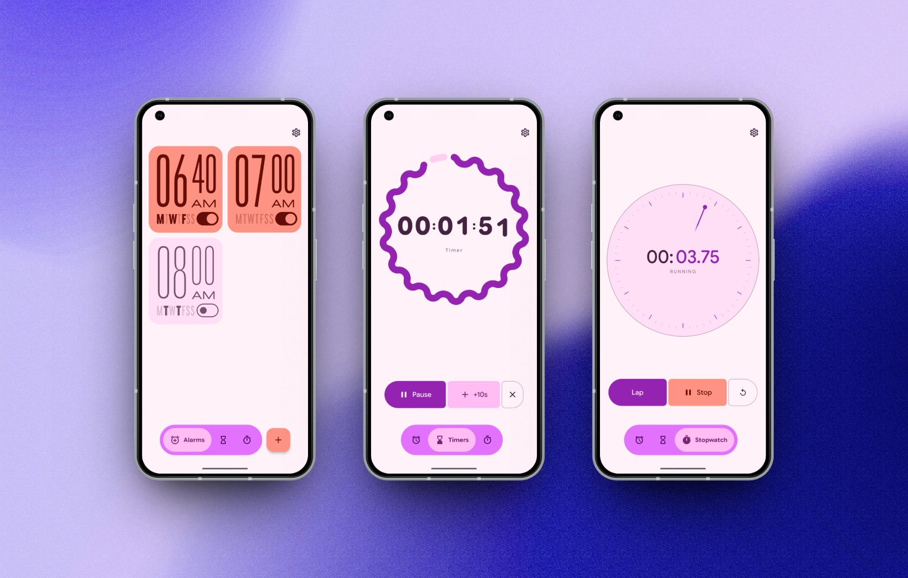
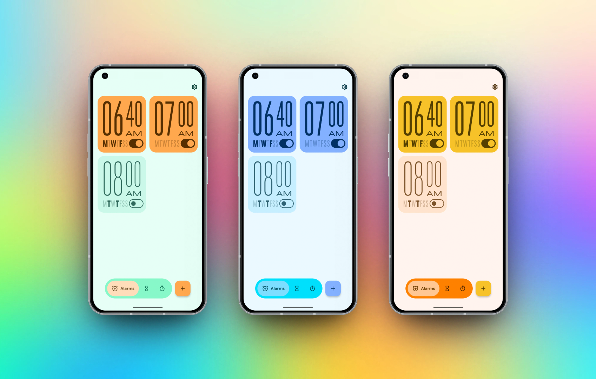
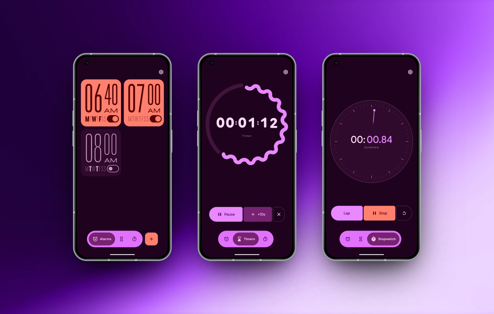
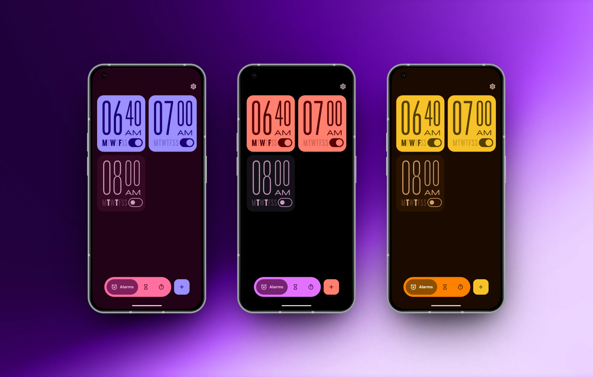
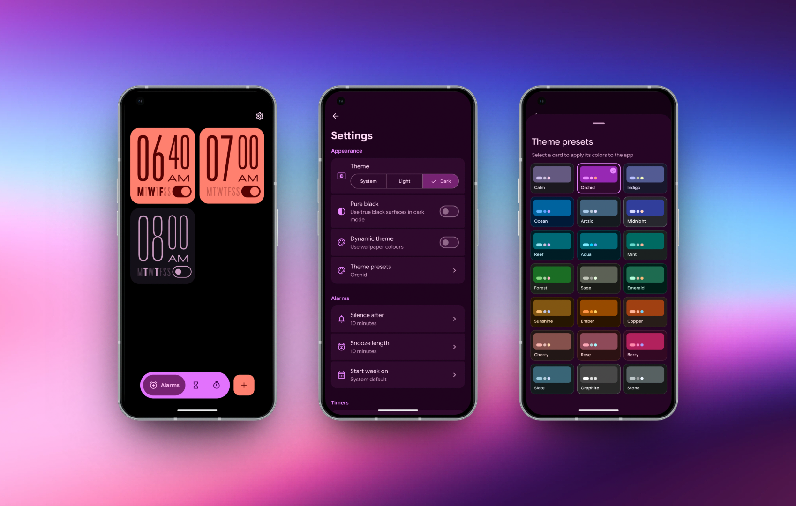

# Expressive Clock

*A Material 3 Expressive clock app for Android.*

Expressive Clock is a personal evolution of [Material Clock](https://github.com/rbouaf/material-clock), an open-source Android clock project created by [Rayane Bouafia (@rbouaf)](https://github.com/rbouaf), forked and extended by [Samuel Beckman (@samuelbeckman)](https://github.com/samuelbeckman) as [Expressive Clock](https://github.com/samuelbeckman/expressive-clock). Huge thanks to both developers for sharing their work and making this project possible.

Building on that foundation, Expressive Clock brings together alarms, a world clock, timers and a stopwatch in a modern Android interface inspired by Google's Material 3 Expressive design language.

  
  

  
  

  

## Features

- **Alarms:** Schedule alarms with ringing and snooze functionality.
- **Timers:** Create and manage countdown timers.
- **Stopwatch:** Track elapsed time.
- **Analog clock widget:** A configurable home-screen clock widget.
- **Expressive design:** Material 3 Expressive styling, Google Sans Flex typography and carefully crafted animations.

Features and behaviour may evolve as the project develops.

## Building from source

Expressive Clock is an Android application built with Kotlin and Jetpack Compose.

1. Clone this repository.
2. Open the project in Android Studio.
3. Allow Gradle to sync and download the required dependencies.
4. Build and run the app on a compatible Android device or emulator.

You can also use the included Gradle wrapper to build the project from the command line.

## Acknowledgements

Expressive Clock builds upon the open-source work of:
- [Rayane Bouafia (@rbouaf)](https://github.com/rbouaf) — original [Material Clock](https://github.com/rbouaf/material-clock) project.
- [Samuel Beckman (@samuelbeckman)](https://github.com/samuelbeckman) — [Expressive Clock](https://github.com/samuelbeckman/expressive-clock) fork that this work is based on.

This project preserves the original licensing and attribution while being developed further under the Expressive Clock name by [dev778g-me](https://github.com/dev778g-me).

## Licence

The project's original source code is licensed under the MIT Licence. See [LICENSE](LICENSE) for the full licence text.

Bundled font files are licensed separately under the SIL Open Font License 1.1. See [THIRD-PARTY-NOTICES.md](THIRD-PARTY-NOTICES.md) and the files in the `licenses/` directory for details.

Google, Google Sans, Material, Android and Pixel are trademarks of Google LLC. Expressive Clock is an independent project and is not affiliated with, sponsored by or endorsed by Google.
